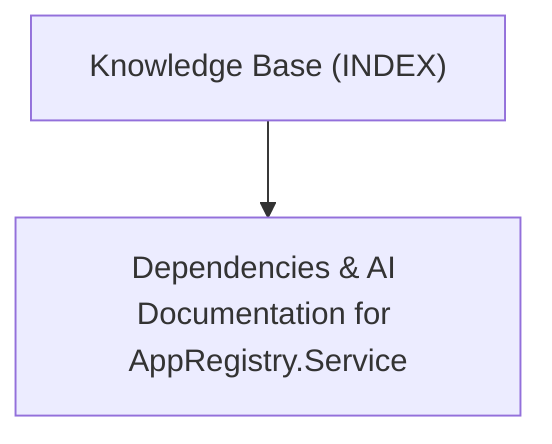

# AppRegistry.Service - Knowledge Base Topic Index

Central entry point and cross-linked topic catalog for project documentation:

## Knowledge Graph & Topic Map

---

## Articles

- **[Dependencies & AI Documentation for AppRegistry.Service](./topic--dependencies.md)** (topic) `dependencies`, `subproject`, `ai-context`, `rules`

---

## Related Context

- Active Issues & History: Tracked in `.along/` (see `AGENTS.md`).
